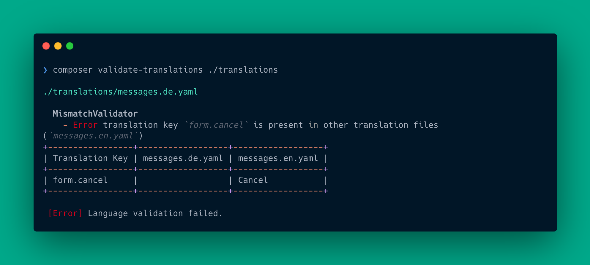

<div align="center">


# Composer Translation Validator

[](https://coveralls.io/github/move-elevator/composer-translation-validator)
[](https://github.com/move-elevator/composer-translation-validator/actions/workflows/cgl.yml)
[](https://github.com/move-elevator/composer-translation-validator/actions/workflows/tests.yml)
[](https://packagist.org/packages/move-elevator/composer-translation-validator)

</div>

Missing keys, duplicate keys, mismatched placeholders and broken HTML in translation files surface at runtime, as raw key names on the page or as formatting errors. This tool finds them before they ship: it groups the language files of a project, compares them and reports the differences.

It runs as a Composer plugin (`composer validate-translations`) and as a standalone PHAR with a GitHub Action and a GitLab CI template. XLIFF, YAML, JSON and PHP files are supported.

## ✨ Features

- **Auto-detection**: pairs language files by [suffix, prefix or directory](https://move-elevator.github.io/composer-translation-validator/reference/file-detection) without configuration
- **Formats**: [XLIFF, YAML, JSON and PHP](https://move-elevator.github.io/composer-translation-validator/reference/file-formats)
- **Validators**: [mismatches, duplicates, placeholders, HTML tags, schema and more](https://move-elevator.github.io/composer-translation-validator/reference/validators)
- **Output**: CLI, JSON and GitHub annotation [formats](https://move-elevator.github.io/composer-translation-validator/reference/cli)
- **Configuration**: [config file](https://move-elevator.github.io/composer-translation-validator/configuration/) in PHP, JSON or YAML

## 🔥 Installation

[](https://packagist.org/packages/move-elevator/composer-translation-validator)
[](https://packagist.org/packages/move-elevator/composer-translation-validator)

```bash
composer require --dev move-elevator/composer-translation-validator
```

> [!IMPORTANT]
> The plugin needs PHP 8.2 or higher and Composer 2.2 or higher. The standalone PHAR, the GitHub Action and the GitLab CI template need PHP 8.4.1 or higher, see the [installation guide](https://move-elevator.github.io/composer-translation-validator/getting-started/installation) for details.

## 🚀 Quick start

```bash
composer validate-translations ./translations
```

The command detects the translation files in the directory, runs the default validators and exits with a non-zero code if it finds errors.



## 📚 Documentation

Full documentation: **[move-elevator.github.io/composer-translation-validator](https://move-elevator.github.io/composer-translation-validator/)**

| Topic | What's inside |
|-------|---------------|
| [Getting started](https://move-elevator.github.io/composer-translation-validator/getting-started/) | What the tool checks, installation paths (Composer, PHAR, GitHub Action, GitLab CI), first run |
| [Configuration](https://move-elevator.github.io/composer-translation-validator/configuration/) | Config file formats, every option, per-validator settings |
| [CLI reference](https://move-elevator.github.io/composer-translation-validator/reference/cli) | Arguments, options, output formats and exit codes |
| [Validators](https://move-elevator.github.io/composer-translation-validator/reference/validators) | What each validator checks, with examples |
| [File formats](https://move-elevator.github.io/composer-translation-validator/reference/file-formats) | Supported formats and their parsing rules |
| [File detection](https://move-elevator.github.io/composer-translation-validator/reference/file-detection) | How language files are grouped into sets |
| [Programmatic usage](https://move-elevator.github.io/composer-translation-validator/reference/programmatic-usage) | Calling the validator from PHP code |

## 🧑‍💻 Contributing

Please have a look at [`CONTRIBUTING.md`](CONTRIBUTING.md).

## ⭐ License

This project is licensed under [GNU General Public License 3.0 (or later)](LICENSE.md).
